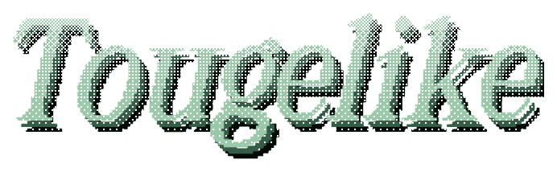
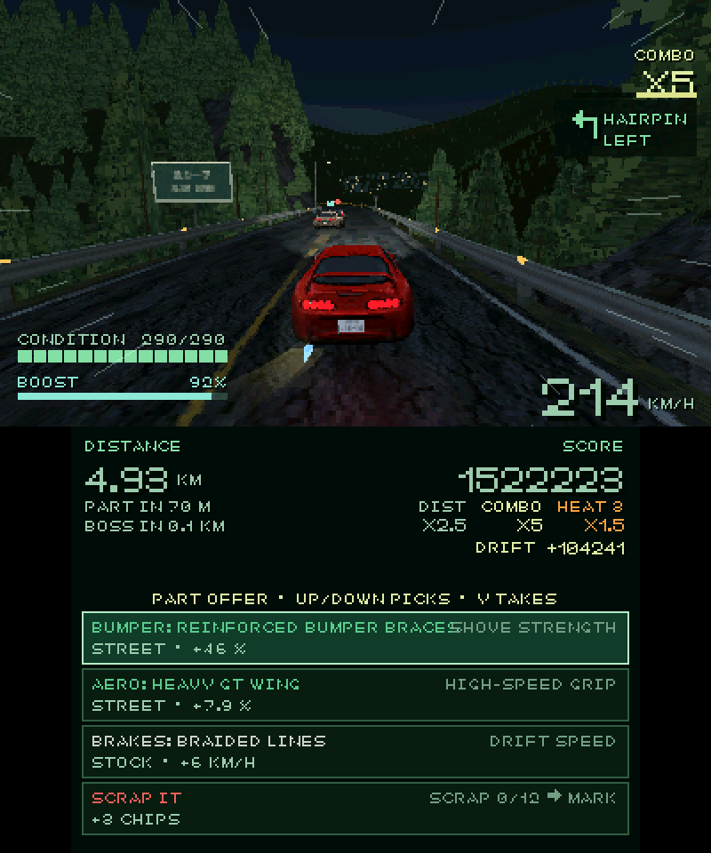
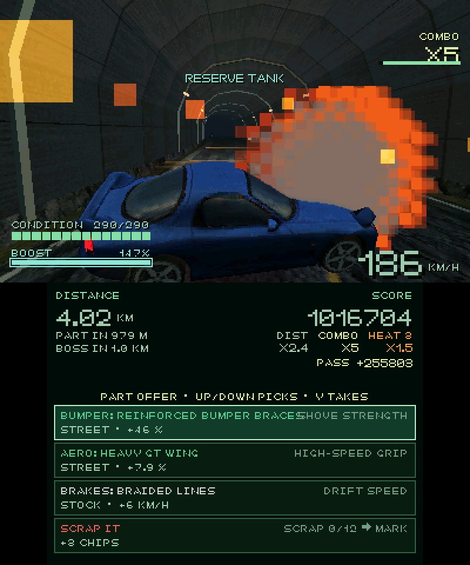
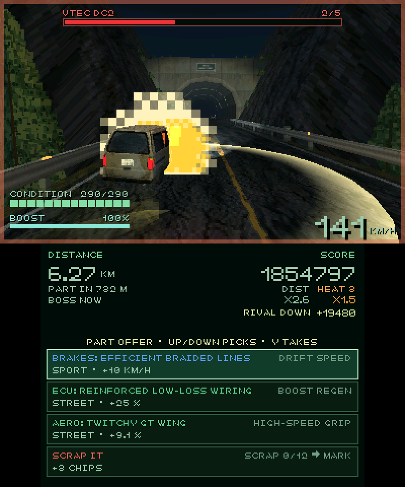
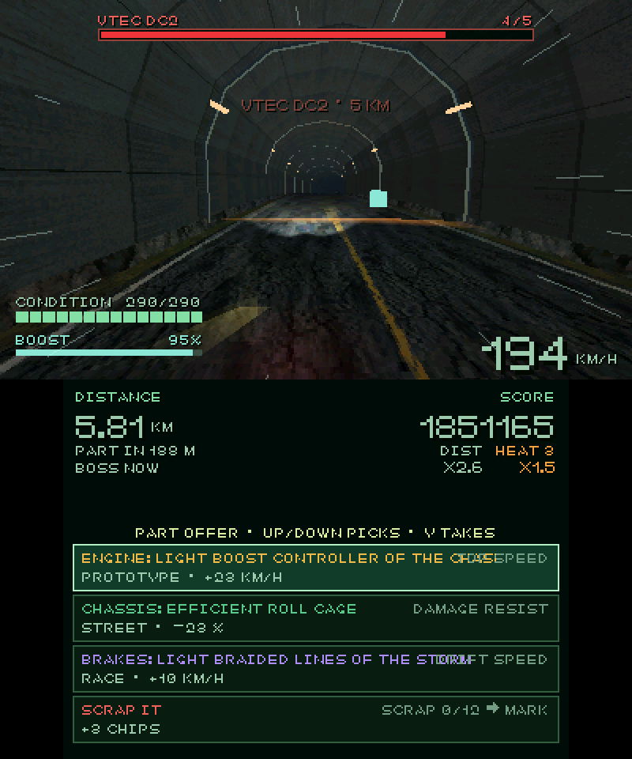
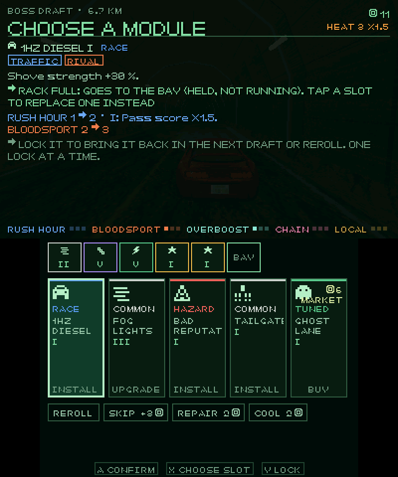
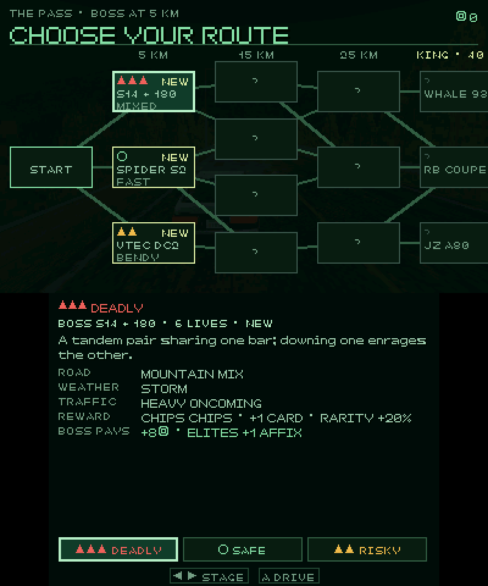
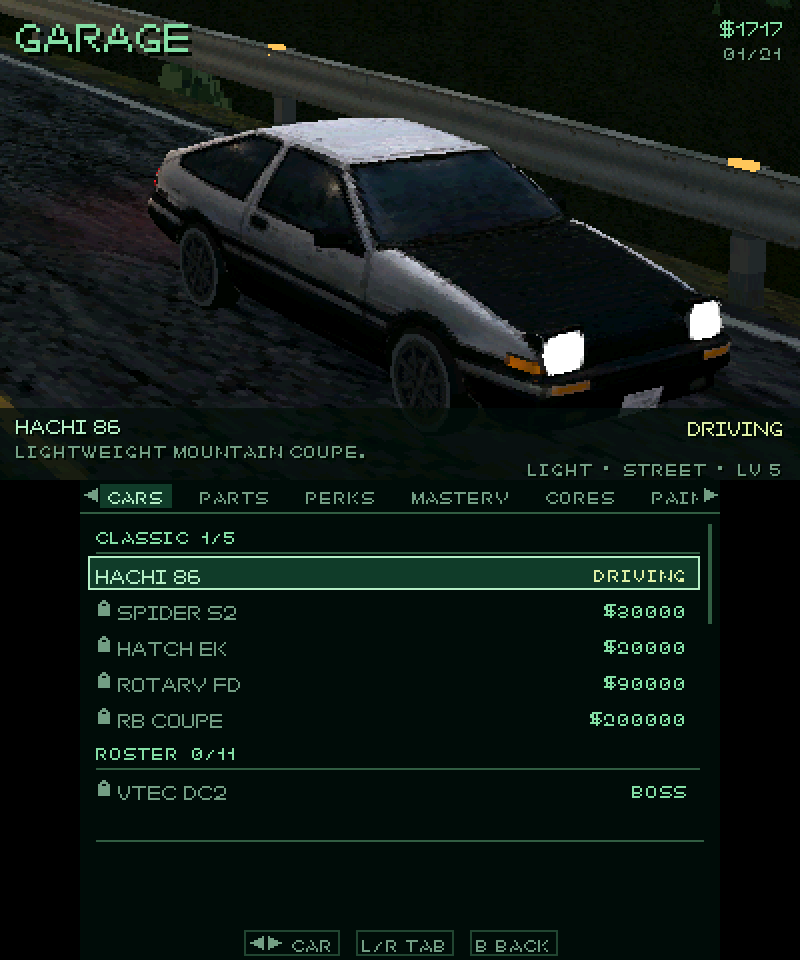
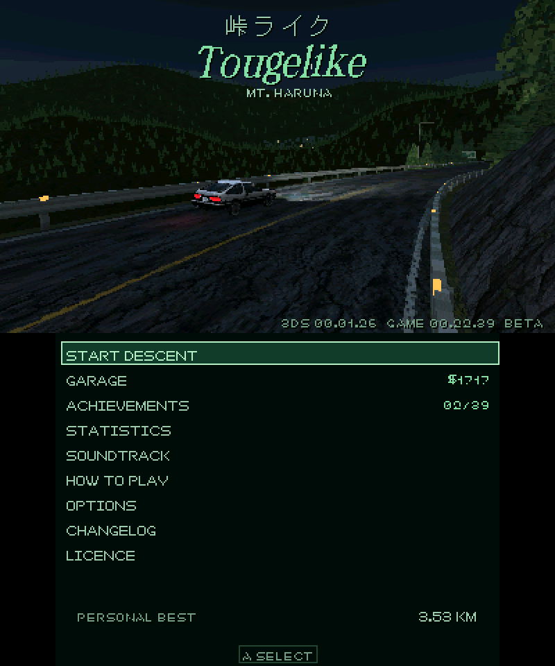
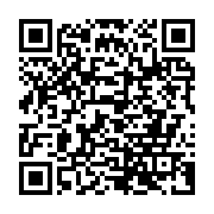

  

# Tougelike for Nintendo 3DS

Retro racing roguelike on Japanese mountain roads, on the Nintendo 3DS and 2DS. Race down touge passes in the dark, drift through the bends, weave through traffic, take down rivals and bosses, and build every run from module drafts. It is the full game from [Tougelike](https://njlent.de/tougelike/), running on the console itself with a two-screen HUD.

**[Download the latest release](https://github.com/njlent/tougelike-3ds-pub/releases/latest)**: a CIA for the HOME Menu, a 3DSX for the Homebrew Launcher and a .3ds for emulators.

No 3DS? Tougelike also runs in the browser at [njlent.de/games/tougelike](https://njlent.de/games/tougelike/), on PC and phone.

## Screenshots

<table>
  <tr>
    <td></td>
    <td></td>
  </tr>
  <tr>
    <td></td>
    <td></td>
  </tr>
  <tr>
    <td></td>
    <td></td>
  </tr>
  <tr>
    <td></td>
    <td></td>
  </tr>
</table>

## Install

- **QR code:** in FBI, choose Remote Install, then Scan QR Code, and scan the code shown here. FBI downloads the newest CIA and installs it to the HOME Menu; the console needs to be online.
- **HOME Menu:** copy the `.cia` to the SD card, open FBI, choose SD, pick the file and install it. Tougelike gets its own icon, banner and jingle on the HOME Menu.
- **Homebrew Launcher:** copy the `.3dsx` to the `/3ds/` folder on the SD card and start it from the Homebrew Launcher.
- **Emulator:** open the `.3ds` or the `.3dsx`, or install the `.cia` with File, Install CIA. The `.3ds` is made for emulators and does not run on a console.

Both keep their saves in the same files on the SD card, so you can switch between them.

## Saves from the web game

Saves move both ways between the browser game and the 3DS, so you can carry on where you left off.

- **Browser to 3DS:** in the web game, open OPTIONS, SAVE and press SAVE to download your save. Copy the file to `/3ds/tougelike/` on the SD card and rename it `import.json`. On the 3DS, open OPTIONS, switch to the SAVE tab with L or R, choose IMPORT FROM SD, check the save it shows and choose LOAD.
- **3DS to browser:** on the same tab, choose EXPORT TO SD. It writes `tougelikeplus-save-<date>.json` to `/3ds/tougelike/`. In the web game, open OPTIONS, SAVE, press LOAD and pick that file.

Loading a save replaces the progress that was there.

## Requirements

- A Nintendo 3DS, 2DS, New 3DS or New 2DS with custom firmware (Luma3DS) to run homebrew.
- For sound, a DSP firmware dump at `sdmc:/3ds/dspfirm.cdc`, made once with DSP1.
- About 60 MB free on the SD card.

## Performance

A New 3DS aims for 60 fps and an Old 3DS or 2DS for 30. Each drops to the next steady rate, 30 or 20, when a busy late-game run gets too heavy. OPTIONS, VISUAL, FRAME RATE holds 30 throughout for players who prefer that.

The speed-ups that came with 3DS 00.01.37 are still experimental. So far they have run in the Azahar emulator and passed one test on a real console. If the picture looks wrong or the game stutters, turn OPTIONS, VISUAL, SECOND CORE off or set FRAME RATE to 30, and tell us what you saw under [Feedback](#feedback).

## Controls

| Button | Driving | Menus |
| --- | --- | --- |
| D-pad or Circle Pad | Steer | Move |
| A | Boost | Choose |
| B | Brake | Back |
| L or R | Drift | Change tab |
| X | Camera | |
| START | Pause | |

Menus also take taps on the bottom screen. Driving is buttons only. The intro is off by default; turn it on under OPTIONS, GAME, INTRO.

## Feedback

Found a bug or have an idea? Post it on the [Tougelike Discord](https://discord.gg/rX5sCHsW6j), where the community and the playtesting are, or [open an issue](https://github.com/njlent/tougelike-3ds-pub/issues) here on GitHub. Either works.
